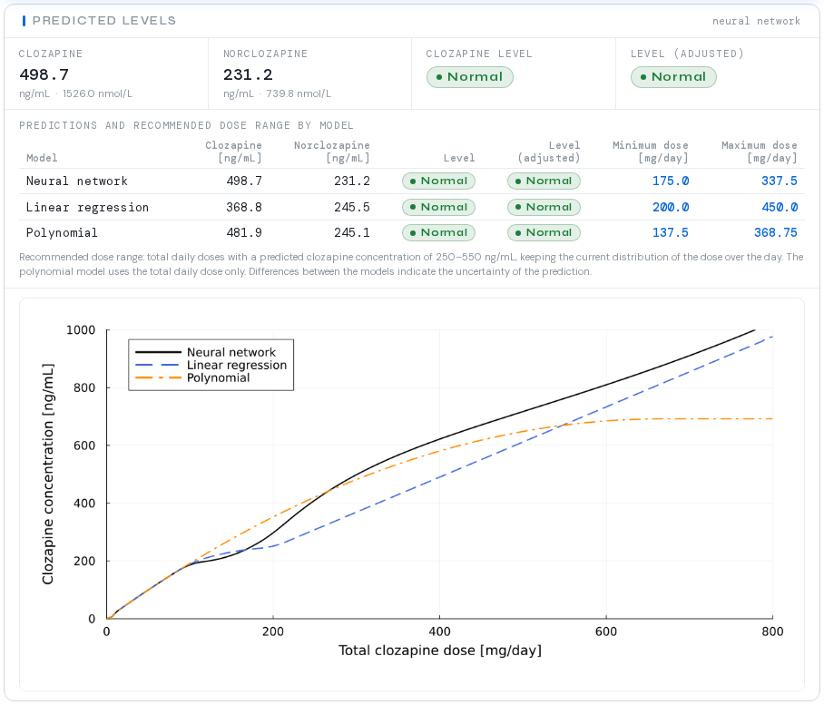

# Clozapine Toxicity Predictor 2.0

[](https://doi.org/10.5281/zenodo.11048224)

This [Julia](https://julialang.org/) toolbox predicts serum [clozapine](https://en.wikipedia.org/wiki/Clozapine) (CLO) and [norclozapine](https://en.wikipedia.org/wiki/Desmethylclozapine) (NCLO) concentrations from basic clinical data, and estimates an individual recommended therapeutic dose range.

The web application is available online at [https://csk.umed.pl/clotop](https://csk.umed.pl/clotop), or it can be run locally (see [Quickstart](#quickstart)).



*Example: man, 35 years, BMI 27 kg/m², CRP 0.7 mg/L, tobacco smoker (one CYP1A2 inducer), clozapine 50 mg in the morning and 250 mg in the evening.*

Concentrations are classified as follows:

- **therapeutic** CLO concentration: 250–550 ng/mL; **toxic**: > 550 ng/mL ([source](https://doi.org/10.1192/bjp.2023.27));
- **adjusted** classification: toxic if CLO > 550 ng/mL or NCLO > 320 ng/mL. No toxicity threshold has been established for NCLO ([AGNP 2026](https://doi.org/10.1055/a-2860-7861)); 320 ng/mL is the NCLO concentration corresponding to CLO = 550 ng/mL at the mean CLO/NCLO ratio of 1.73 ([Schoretsanitis et al., 2019](https://doi.org/10.1080/17512433.2019.1617695); [Meyer, 2024](https://doi.org/10.1016/j.schres.2023.10.041)).

The **recommended dose range** is the range of total daily doses (0–800 mg/day) for which the predicted CLO concentration is within 250–550 ng/mL. It is calculated for the patient's current distribution of the dose over the day (e.g., 1/6 in the morning and 5/6 in the evening for 50 + 250 mg); a different distribution may result in a different range.

---

# What's new in version 2.0

Version 2.0 is the default branch ([`2.0`](https://codeberg.org/AdamWysokinski/CloToP.jl/src/branch/2.0)) of this repository. Version 1.0 ([Wysokiński & Dreczka, 2024](https://doi.org/10.1016/j.psychres.2024.116256)) is available in the [`1.0`](https://codeberg.org/AdamWysokinski/CloToP.jl/src/branch/1.0) branch. Changes in version 2.0:

- **Dosing schedule**: morning, midday, and evening doses are entered separately. Four representations of the dose were compared (three doses; total dose; total dose + MM index; total dose + morning and midday doses). The deployed model uses the **total daily dose, morning dose, and midday dose**.
- **Independent CLO and NCLO models**: version 1.0 predicted NCLO first and used it as an input of the CLO model.
- **Network**: three hidden layers (128, 64, 32 neurons, Swish activation, dropout), mean absolute error loss, AdamW optimizer with an elastic net penalty; sex and numbers of CYP inducers/inhibitors/substrates enter the network as categorical features (entity embeddings).
- **Validation without information leakage**: 80:20 split at the patient level with a fixed random seed; hyperparameters selected by 6-fold patient-level cross-validation within the training group; the testing group is never used for model selection.
- **Low doses** (≤ 100 mg/day, not represented in the training data): concentrations are predicted by polynomial models through the origin (order selected by BIC; currently quadratic) instead of the neural network.
- Larger dataset: 123 patients, one observation per patient.

---

# Inputs

| Input                                                              | Allowed range | Training data range |
| ------------------------------------------------------------------ | ------------- | ------------------- |
| Biological sex                                                     | female/male   |                     |
| Age [years]                                                        | 18–70         | 18–73               |
| BMI [kg/m²]                                                        | 17–45         | 17.4–43.3           |
| CRP [mg/L]                                                         | 0–80          | 0.2–81.4            |
| Morning / midday / evening clozapine dose [mg]                     | 0–400 / 0–400 / 0–800 | 0–375 / 0–200 / 50–600 |
| Total daily dose [mg/day]                                          |               | 100–775             |
| Numbers of CYP3A4 and CYP1A2 inducers, inhibitors, and substrates  | 0–5           | see below           |

Tobacco smoking counts as one CYP1A2 inducer. None of the patients in the training data took CYP1A2 inhibitors or CYP3A4 inducers, so these inputs currently have no effect. Numbers of CYP drugs not present in the training data are replaced by the nearest lower number that is present (e.g., 4 CYP3A4 substrates are treated as 3). Predictions outside the training data ranges are extrapolations and should be interpreted with caution.

---

# Performance

Performance of the deployed model (total dose + morning/midday doses) in the testing group (24 patients not used for training or model selection):

| Target | RMSE [ng/mL] | R²    | MAE [ng/mL] |
| ------ | ------------ | ----- | ----------- |
| CLO    | 274.6        | −0.12 | 189.7       |
| NCLO   | 85.7         | 0.19  | 58.3        |

**Prediction errors are large.** For CLO, none of the neural network models outperformed a simple quadratic model of the total daily dose in the testing group (RMSE 209.3 ng/mL), so individual predictions may differ from measured concentrations by several hundred ng/mL. The tool does not replace therapeutic drug monitoring.

All performance measures (training, testing, and final models for all four dose representations) are in [`reports/performance.csv`](reports/performance.csv); the training log is in [`reports/report.txt`](reports/report.txt). The models are under active development and we expect their accuracy to improve as more data are collected.

---

# Quickstart

1. **Install Julia** from [julialang.org/downloads](https://julialang.org/downloads/) (tested with Julia 1.13).
2. Clone this repository, go to its directory, and install the required packages (only once):

    ```sh
    julia src/install.jl
    ```

3. Start the server:

    ```sh
    julia src/server.jl
    ```

The server listens on port 8080. Open [http://localhost:8080](http://localhost:8080) in your browser, enter the patient's data, and click **Run Prediction**.

---

# Training

The models are trained from [`data/clozapine.csv`](data/clozapine.csv):

```sh
julia -t auto src/train.jl 2>&1 | tee reports/report.txt              # all four dose representations
julia -t auto src/train.jl totaldose_morn_midday                       # selected representation(s) only
```

Available representations: `threedoses`, `totaldose`, `totaldose_mm`, `totaldose_morn_midday`. Hyperparameter tuning takes several hours per representation. The script writes the models and scalers to [`models`](models), and performance measures, prediction errors, and figures to [`reports`](reports). Restart the server after retraining to load the new models.

| Path               | Contents                                                     |
| ------------------ | ------------------------------------------------------------ |
| `src/train.jl`     | model training and evaluation                                |
| `src/server.jl`    | prediction server (web application backend)                  |
| `src/install.jl`   | installation of the required packages                        |
| `index.html`       | web application frontend                                     |
| `data/`            | training data                                                |
| `models/`          | trained models, scalers, and polynomial low-dose models      |
| `reports/`         | performance measures, prediction errors, figures, training log |

---

# Unit conversion

Conversion factors from ng/mL to nmol/L ([source](https://testguide.adhb.govt.nz/EGuide/?elv=1&name=Clozapine&pn=1672&mn=833&sd=3&ts=148a090cbe5)):

- clozapine: 3.06
- norclozapine: 3.20

---

# How to Cite

If you use this tool, please cite our [paper](https://doi.org/10.1016/j.psychres.2024.116256):

```bibtex
@article{wysokinski_2024,
    title = {Clozapine Toxicity Predictor: deep neural network model predicting clozapine toxicity and its therapeutic dose range},
    journal = {Psychiatry Research},
    volume = {342},
    pages = {116256},
    year = {2024},
    issn = {0165-1781},
    doi = {10.1016/j.psychres.2024.116256},
    url = {https://www.sciencedirect.com/science/article/pii/S0165178124005419},
    author = {Adam Wysokiński and Joanna Dreczka},
}
```

## Contributors

|                          Name                           |                       Affiliation                        |
| ------------------------------------------------------- | -------------------------------------------------------- |
| [Adam Wysokiński](mailto:adam.wysokinski@umed.lodz.pl)  | Department of Old Age Psychiatry and Psychotic Disorders |
| [Joanna Dreczka](mailto:jdreczka@csk.umed.pl)           | Department of Old Age Psychiatry and Psychotic Disorders |
| [Aleksandra Sosińska](mailto:ola.g.sosinska@gmail.com)  | Department of Old Age Psychiatry and Psychotic Disorders |
| [Michał Karbownik](mailto:michal.karbownik@umed.lodz.pl) | Department of Pharmacology and Toxicology                |

[](https://en.umed.pl)

## License

This software is licensed under [The 2-Clause BSD License](LICENSE).

## Disclaimers

**DISCLAIMER: RESEARCH USE ONLY (RUO)**

This tool and all associated materials (text, graphics, images, etc.) are for scientific research only and must not be used for diagnostic or medical purposes.

**DISCLAIMER: NOT MEDICAL ADVICE**

This tool does not provide medical advice.
